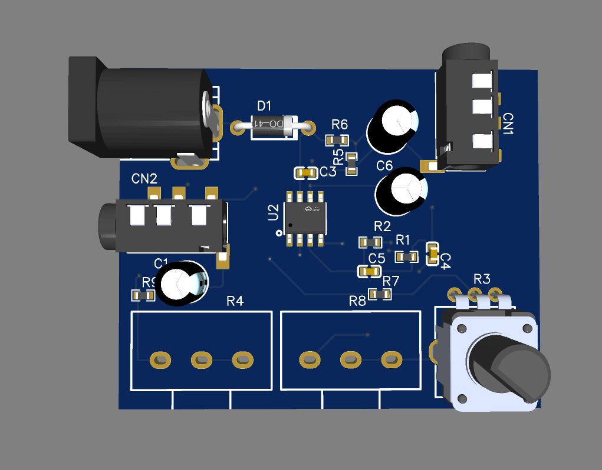
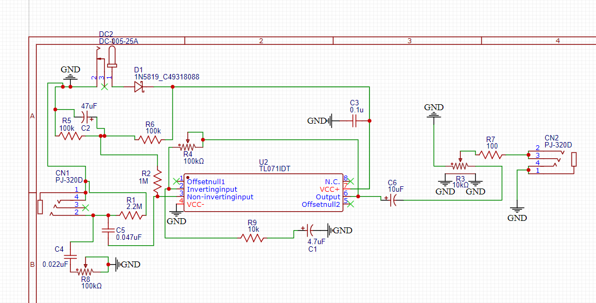
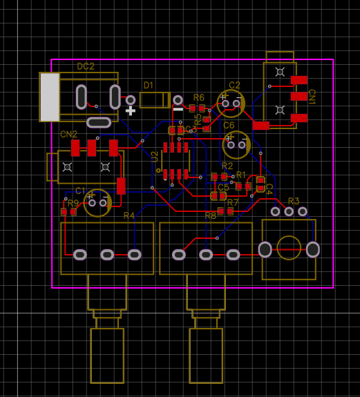

# TL071 Guitar Preamp

A compact, single-supply analog guitar preamp built around the `TL071IDT` JFET-input operational amplifier. It takes a high-impedance passive guitar pickup signal and converts it into a boosted, low-impedance output suitable for driving a PC line-in, audio interface, camera mic input, or practice amp via standard 3.5mm cables.

## What It Does

Passive guitar pickups have a high output impedance and weak signal level. Plugging them directly into standard consumer audio inputs (like a computer soundcard or camera) loads down the pickup, killing high-end frequencies and resulting in a thin, quiet sound. 

This board fixes that by providing:
- **High-impedance buffering:** Prevents pickup loading so the guitar retains its natural tone.
- **Variable clean boost:** Adjustable gain from $1\times$ ($0\text{ dB}$) up to $11\times$ ($+20.8\text{ dB}$).
- **Passive treble roll-off:** Input-side tone control that works directly against the pickup's inductance, just like the tone knob built into a guitar.
- **Dual-mono 3.5mm output:** Splits the mono guitar signal to both Left (Tip) and Right (Ring) channels so it plays in both ears on standard stereo AUX cables.
- **9V to 12V DC operation:** Runs on a standard 9V battery (via a barrel-plug snap) or a 12V center-positive wall adapter for extra headroom.

---

## How It Works

### 1. Power Supply & Virtual Ground
Because a guitar signal swings both positive and negative (AC) while the power source is a single DC rail ($+9\text{V}$ or $+12\text{V}$ on `DC2`), the op-amp needs a half-supply DC bias point to avoid clipping the bottom half of the waveform:
- **`D1` (`1N5819`):** Series Schottky diode at the DC input for reverse-polarity protection.
- **`R5` ($100\text{ k}\Omega$) & `R6` ($100\text{ k}\Omega$):** Voltage divider between `VCC+` and `GND` that creates a virtual ground reference (`VREF`) at $\frac{1}{2}V_{CC}$ ($+4.5\text{V}$ on a 9V supply, $+6\text{V}$ on a 12V supply).
- **`C2` ($47\ \mu\text{F}$):** Stabilizes `VREF` and filters out power supply ripple so it doesn't enter the audio path.
- **`C3` ($0.1\ \mu\text{F}$):** Local high-frequency decoupling capacitor placed right across the `TL071IDT` power pins.

### 2. Input Stage & Tone Control
- **`CN1` (`PJ-320D`):** 3.5mm input jack (used with a 1/4" to 3.5mm adapter).
- **`R1` ($2.2\text{ M}\Omega$):** Pull-down resistor to `GND` at the input jack to drain static charge and prevent loud popping noises when plugging in.
- **`C4` ($0.022\ \mu\text{F}$) & `R8` ($100\text{ k}\Omega$ Linear Pot):** Shunt tone filter placed before the input coupling capacitor. Turning `R8` counter-clockwise reduces resistance to ground through `C4`, bleeding off harsh high frequencies above $\sim 1.5\text{ kHz}$.
- **`C5` ($0.047\ \mu\text{F}$) & `R2` ($1\text{ M}\Omega$):** `C5` blocks DC from reaching the guitar and feeds the AC guitar signal into Pin 3 (`IN+`) of `U2`. `R2` biases Pin 3 to `VREF` while presenting a $1\text{ M}\Omega$ input impedance to the pickup.

### 3. Amplification / Gain Stage
- **`U2` (`TL071IDT`):** Configured as a non-inverting amplifier.
- **`R4` ($100\text{ k}\Omega$ Pot), `R9` ($10\text{ k}\Omega$), & `C1` ($4.7\ \mu\text{F}$):** Forms the negative feedback network between Pin 6 (`Output`) and Pin 2 (`IN-`). `C1` blocks DC in the feedback path so the op-amp always maintains $1\times$ DC gain (keeping the output centered at `VREF`) while amplifying AC audio according to:
  $$A_v = 1 + \frac{R_4}{R_9}$$
  This gives a continuous gain range from $1\times$ ($R_4 = 0\ \Omega$) to $11\times$ ($R_4 = 100\text{ k}\Omega$).

### 4. Output Stage & Volume Control
- **`C6` ($10\ \mu\text{F}$):** DC-blocking capacitor that strips the $+4.5\text{V}/+6\text{V}$ `VREF` offset off the amplified signal leaving Pin 6.
- **`R3` ($10\text{ k}\Omega$ Pot):** Standard voltage-divider volume control at the output, which also acts as a low-impedance pull-down path for `C6`.
- **`R7` ($100\ \Omega$):** Series isolation resistor on the output wiper to prevent op-amp oscillation when driving capacitive loads like long AUX cables.
- **`CN2` (`PJ-320D`):** 3.5mm output jack with Pins 2 (Tip) and 3 (Ring) tied together for dual-mono output.

---

## PCB Layout

The board uses a 2-layer layout designed in EasyEDA, combining 0603 SMD passives and an SOIC-8 op-amp with through-hole electrolytic capacitors, potentiometers, and a 2.5mm DC barrel jack (`DC-005-25A`).

---

## Bill of Materials (BOM)

| Designator | Component / Value | Package | Part Number | LCSC Part # |
| :--- | :--- | :--- | :--- | :--- |
| **`U2`** | Op-Amp (`TL071IDT`) | SOIC-8 | `TL071IDT` | `C2652251` |
| **`CN1`, `CN2`** | 3.5mm Audio Jack | SMD | `PJ-320D` | `C431535` |
| **`DC2`** | DC Barrel Jack ($5.5\times 2.5\text{mm}$) | Through-Hole | `DC-005-25A` | `C136715` |
| **`D1`** | Schottky Diode (`1N5819`) | DO-41 | `1N5819` | `C49318088` |
| **`R3`** | $10\text{ k}\Omega$ Potentiometer (Volume) | Through-Hole (9mm) | `RK09K1130A6S` | `C209770` |
| **`R4`, `R8`** | $100\text{ k}\Omega$ Potentiometer (Gain, Tone) | Through-Hole (17mm) | `PDB181-K220K-104B` | `C6357164` |
| **`C1`** | $4.7\ \mu\text{F}$ Electrolytic Capacitor | Radial ($5\text{mm}$, $P=2.0\text{mm}$) | — | — |
| **`C2`** | $47\ \mu\text{F}$ Electrolytic Capacitor | Radial ($5\text{mm}$, $P=2.0\text{mm}$) | `ERS1EM470D11OT` | `C106650` |
| **`C6`** | $10\ \mu\text{F}$ Electrolytic Capacitor | Radial ($5\text{mm}$, $P=2.0\text{mm}$) | — | — |
| **`C3`** | $0.1\ \mu\text{F}$ ($100\text{ nF}$) Ceramic Capacitor | 0603 | Generic 0603 | — |
| **`C4`** | $0.022\ \mu\text{F}$ ($22\text{ nF}$) Ceramic Capacitor | 0603 | Generic 0603 | — |
| **`C5`** | $0.047\ \mu\text{F}$ ($47\text{ nF}$) Ceramic Capacitor | 0603 | Generic 0603 | — |
| **`R1`** | $2.2\text{ M}\Omega$ Resistor | 0603 | Generic 0603 | — |
| **`R2`** | $1\text{ M}\Omega$ Resistor | 0603 | Generic 0603 | — |
| **`R5`, `R6`** | $100\text{ k}\Omega$ Resistor | 0603 | Generic 0603 | — |
| **`R7`** | $100\ \Omega$ Resistor | 0603 | Generic 0603 | — |
| **`R9`** | $10\text{ k}\Omega$ Resistor | 0603 | Generic 0603 | — |